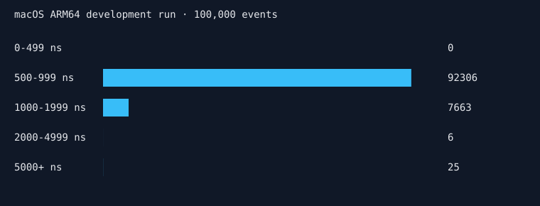
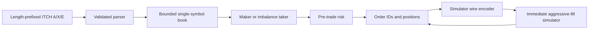

# hft-engine





**Working prototype, not a completed exchange engine.** The sub-5 µs target remains unverified on Linux x86-64. No live connectivity or real-money support. Current benchmark exercises a one-sided book and emits no order; it cannot establish tick-to-trade performance.

| Measured stage | p50 ns | p99 ns | p99.9 ns |
|---|---:|---:|---:|
| Parse → book → decision → rejected empty intent | 750 | 1167 | 1209 |
| Separate parser/book/signal/risk/encode stages | unmeasured | unmeasured | unmeasured |
| Full tick-to-trade on Linux | unmeasured | unmeasured | unmeasured |

Development measurement: Apple Clang 21, macOS ARM64, `-O3`, steady_clock, 10,000 warm-up events and 100,000 samples. Includes timer overhead; core unpinned. Raw [JSON](docs/latency-macos.json) and [histogram counts](docs/histogram-macos.csv) are committed. No throughput or zero-allocation claim has been established by measurement.

## Reproduce

```sh
cmake --preset debug
cmake --build build/debug
ctest --test-dir build/debug --output-on-failure
python3 tools/generate_fixture.py
build/debug/hft_replay maker tests/fixtures/synthetic.itch build/debug/maker.orders
build/debug/hft_replay taker tests/fixtures/synthetic.itch build/debug/taker.orders
cmake -S . -B build/bench -G Ninja -DCMAKE_BUILD_TYPE=Release -DHFT_NATIVE=ON
cmake --build build/bench
# Linux dedicated core; stderr contains histogram counts
 taskset -c 2 build/bench/hft_bench > latency.json 2> histogram.csv
```

Repeat replay twice and `cmp` order files. CI performs this for both strategies. Builds require CMake ≥3.24, Ninja and a C++20 compiler. No third-party runtime dependencies. Exceptions/RTTI disabled; native tuning applies only to the benchmark target. Presets include debug, relwithdebinfo, release with LTO, ASan/UBSan and TSan.

## Scope and next steps

The parser supports exact ITCH 5.0 A, X and E payload layouts. Input is two-byte big-endian length-prefixed records. Unsupported messages stop replay with an error: a full NASDAQ day is **not supported**. Feed symbol/locate routing is not implemented; use single-symbol fixtures only. Book bounds are 8192 orders, 2048 price ticks starting at 99000. Overflow and invalid updates fail closed. Best prices scan the bounded levels; FIFO, sparse far levels, modify/replace/delete and snapshots remain pending.

Maker alternates side by inventory and quotes the touch; micro-price/skew and quote cancellation remain pending. Taker uses 2:1 touch-depth imbalance. Simulator fills crossing orders immediately without consuming historical depth; passive quotes never fill. No queue-position or latency model. Risk covers size, position, absolute price and kill gating; outstanding exposure, self-trade checks, notional limits, throttles, cancel-all and control socket remain pending. OMS tracks IDs, cash and position; the declared state enum is not yet a state machine. Wire format is private, **not OUCH**; exchange encoding/session recovery remains pending. SPSC ring is tested, but async logger, calibrated TSC and HdrHistogram are not integrated.

CI covers GCC/Clang, sanitizers, malformed-input fuzzing and deterministic replay. Benchmark regression is configured for an opt-in dedicated self-hosted runner, using an externally provisioned baseline; it does not run on noisy shared runners. Property/golden full-day tests and allocation auditing remain pending.

See [design decisions](docs/decisions.md), [backtest report](docs/backtest.md), [write-up](docs/building-sub-5us.md), and [reading list](docs/reading-list.md).
