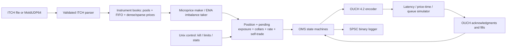

# hft-engine




C++20 single-process simulation engine. Replay and UDP use the same parser, books, strategies, risk, OMS and simulator. Public GitHub repository; no real-money/exchange connectivity.

The implementation includes all displayed-book ITCH mutations, all standard administrative layouts, instrument routing, pooled FIFO storage, dense/sparse prices, two reference strategies, pending-exposure risk, cancel/replace races, OUCH messages, SoupBinTCP session/loopback transport, latency and queue models, deterministic logs, binary snapshots/recovery, async logging, Linux affinity/huge-page advice/mlock options, HdrHistogram and allocation-audited benchmarks.

Measured on **AMD EPYC 9V74 80-Core Processor** using a **shared Linux x86-64 GitHub runner**, pinned to one available core with calibrated invariant TSC; GCC 13.3.0, Release `-O3`, benchmark-only `-march=native`. Twenty repetitions × 100000 market-data events; each repetition encodes 50000 new orders. Table entries are medians of per-run percentiles. The histogram shows run 1.

| Stage | p50 ns | p99 ns | p99.9 ns |
|---|---:|---:|---:|
| parse | 40 | 40 | 50 |
| book | 50 | 60 | 90 |
| signal | 40 | 50 | 50 |
| risk | 40 | 40 | 50 |
| encode | 50 | 60 | 70 |
| tick to trade | 320 | 345 | 520 |
| total event | 500 | 550 | 816 |

Uninstrumented core throughput: **4.71 million messages/s**. Audited C++ allocations in the warmed processing loop: **0**. [Raw runs and metadata](docs/bench/linux/) · [public benchmark run](https://github.com/aerraj/hft-engine/actions/runs/38088662815). Book-stage timing includes validation and simulation bookkeeping; isolated book microbenchmarks are published separately.

**Validation boundaries:** these are synthetic workload smoke measurements, not dedicated-host real-data acceptance or wire-to-wire latency. The million-message determinism/stress test is synthetic. Full historical-day equality against an exchange reference snapshot remains unverified. The simulator models counterfactual fills; its PnL is not evidence of profitability. [Exact assumptions and complexities](docs/design.md).

## Build and run

```sh
cmake --preset debug
cmake --build build/debug -j 4
ctest --test-dir build/debug --output-on-failure
python3 tools/generate_fixture.py
build/debug/hft_replay maker tests/fixtures/synthetic.itch build/debug/maker --metrics
build/debug/hft_replay taker tests/fixtures/synthetic.itch build/debug/taker --metrics
python3 tools/report.py build/debug/maker.orders --out build/debug/maker-report
```

CMake ≥3.24, Ninja, C++20, POSIX and Python ≥3.9. GCC 14 and Clang 18 CI builds. Dependencies are pinned to immutable commits via CMake; optional vcpkg manifest supplies GoogleTest/Benchmark. Presets cover Debug, RelWithDebInfo, Release+LTO, ASan/UBSan and TSan. `-fno-exceptions -fno-rtti` applies to engine targets; `-march=native` is benchmark-only.

## Benchmarks

```sh
cmake -S . -B build/bench -G Ninja -DCMAKE_BUILD_TYPE=Release -DHFT_NATIVE=ON
cmake --build build/bench -j 4
# Linux, available isolated core 2:
python3 tools/run_benchmarks.py build/bench/hft_bench --core 2 --out latency --repetitions 20
python3 tools/latency_report.py latency
build/bench/hft_microbench --benchmark_repetitions=20
```

The benchmark forces outgoing quotes, measures p50/p90/p99/p99.9/max per stage and audits C++ heap allocations after warm-up. Throughput is measured separately without timestamp/histogram overhead. The report records timer/compiler/platform, native flags and source digest. Fixed-seed replay determinism excludes wall-clock performance records. Use `--config config/default.conf` to load startup limits; later CLI flags override earlier settings. Use `--config config/default.conf` to load startup limits; later CLI flags override earlier settings. Use `--config config/default.conf` to load startup limits; later CLI flags override earlier settings. Use `--config config/default.conf` to load startup limits; later CLI flags override earlier settings.

See [benchmark artifacts](docs/bench/), [design/complexities](docs/design.md), [decisions with paired measurements](docs/decisions.md), [backtest reports](docs/backtest.md), [implementation write-up](docs/building-sub-5us.md), [operations and data](docs/operations.md), and [reading list](docs/reading-list.md).

CI runs randomized book/reference tests, golden replay, byte-identical logs, ASan/UBSan, TSan, fuzzing and UDP/TCP loopback. Shared-runner benchmark checks are smoke tests. The 10% p99 regression gate requires a dedicated self-hosted runner and host-matched baseline (see operations).
